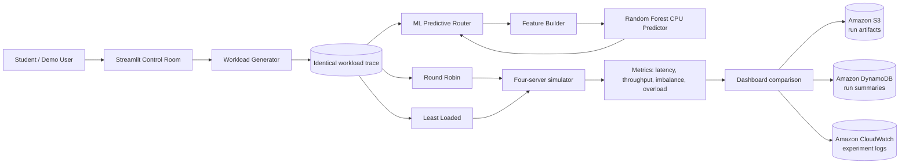

# CloudBalancer architecture

The simulator is the experimental environment. AWS stores and observes experiment outputs; it is not presented as a claim that real production traffic is being balanced by AWS infrastructure.
